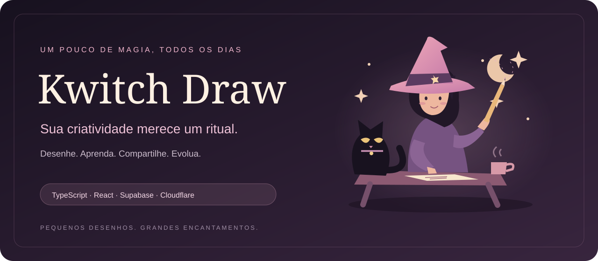
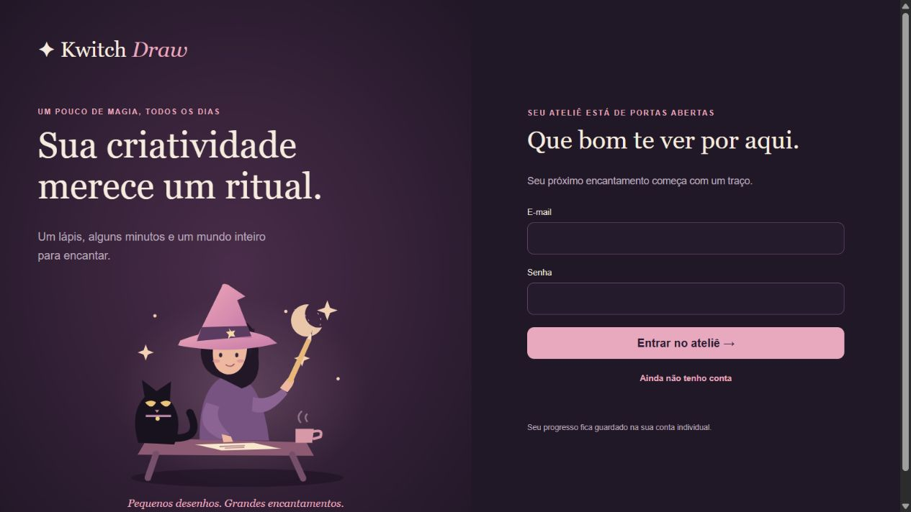
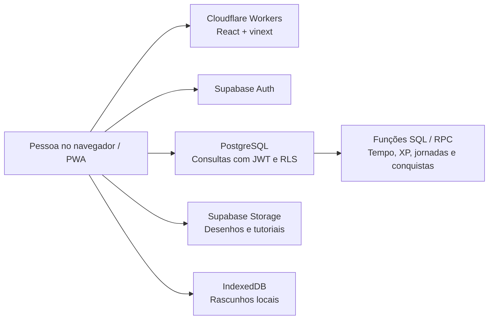

<p align="center">
  
</p>

<p align="center">
  <strong>Um ateliê de desenho que combina prática diária, aprendizado guiado e evolução pessoal.</strong><br />
  Pequenos desenhos. Grandes encantamentos.
</p>

<p align="center">
  <a href="https://kwitch-draw.tatatech.workers.dev/">✦ Experimentar o aplicativo</a> ·
  <a href="#o-que-eu-construí">O projeto</a> ·
  <a href="#tecnologias-e-linguagens">Tecnologias</a> ·
  <a href="GUIA-INSTALACAO.md">Instalação completa</a>
</p>

<p align="center">
  
  
  
  
  
  
</p>



## O que eu construí

O **Kwitch Draw** transforma a prática de desenho em um ritual criativo: a pessoa escolhe uma atividade, acompanha um guia quando quiser, desenha no próprio aplicativo ou no papel e guarda o resultado na sua conta.

Construí uma aplicação web com interface em português, identidade visual de fantasia, autenticação individual, progressão por XP, comunidade e ferramentas administrativas. O projeto conecta experiência visual, desenho interativo e regras de negócio executadas no PostgreSQL.

> **O diferencial técnico:** recompensas, tempo de prática e permissões são validados no banco. A interface apresenta a experiência; as funções SQL controlam as operações que precisam de consistência.

## Uma experiência completa de criação

| Área | O que a pessoa pode fazer |
| --- | --- |
| ✏️ Desenho digital e papel | Usar pincel, cores, borracha e desfazer, ou enviar uma foto do desenho. Rascunhos locais ficam separados por conta e atividade. |
| 🌙 Desafios e jornadas | Praticar com desafio diário, filtros por categoria/dificuldade, jornadas sequenciais e cronômetro com pausa e retomada. |
| 📖 Aprendizado visual | Alternar entre Modo Livre e Guiado, consultar etapas ilustradas, aulas, dicas e práticas da Academia. |
| ✨ Progressão | Acompanhar XP, níveis, sequência de dias e conquistas, com recompensas validadas no servidor de banco. |
| 🐈 Identidade pessoal | Personalizar perfil e familiar com espécie, cor, amuleto, nome e personalidade. |
| 🎨 Comunidade | Manter desenhos privados ou publicar por escolha própria, consultar o histórico e denunciar conteúdo. |
| 🛠️ Administração | Moderar a comunidade, responder atendimentos e editar tutoriais com rascunho, prévia, controle de revisão e publicação. |
| 📱 Experiência instalável | Usar manifest, ícones e service worker de PWA, com suporte a rascunho local e página offline. Operações de conta e sincronização exigem conexão. |

O catálogo distribuído inclui **482 atividades**, **47 aulas/dicas**, **529 guias visuais** e **2.650 etapas ilustradas em SVG**. Os guias usam exemplos vetoriais estilizados como apoio à prática.

## Tecnologias e linguagens

| Tecnologia | Como foi usada |
| --- | --- |
| **TypeScript / TSX** | Linguagem principal da aplicação: componentes, tipos de domínio, desenho, perfis e integração com o banco. |
| **React 19** | Componentes e estado da interface, quadro de desenho, jornadas e painel administrativo. |
| **CSS** | Layout responsivo, paleta, tipografia, estados de interação e identidade visual. |
| **SQL / PostgreSQL** | Estrutura do banco, migrations, catálogos, regras de acesso e funções de negócio chamadas por RPC. |
| **JavaScript / Node.js** | Scripts de geração de conteúdo, ícones e testes automatizados com `node:test`. |
| **Supabase** | Autenticação, PostgreSQL e armazenamento de desenhos e imagens, com URLs temporárias e políticas de acesso. |
| **vinext + Vite** | App Router compatível com Next.js, desenvolvimento e build para o ambiente Cloudflare. |
| **Cloudflare Workers** | Publicação da aplicação, entrega de arquivos e rota de saúde. |
| **IndexedDB + Pointer Events** | Persistência dos rascunhos no navegador e entrada de traços no quadro. |
| **PGlite** | Testes locais de PostgreSQL para regras de negócio e isolamento entre contas. |

**TypeScript é a linguagem principal; React é a biblioteca de interface.** O backend de negócio fica nas funções PostgreSQL do Supabase; Node.js é usado no desenvolvimento e nos testes, e a aplicação publicada roda no runtime Workers.

## Arquitetura



### Decisões que fazem parte da implementação

- **Isolamento entre contas:** Row Level Security e permissões por coluna protegem dados pessoais e operações administrativas.
- **Recompensas consistentes:** a conclusão e o XP passam por funções SQL; alterações diretas de XP pelo participante são bloqueadas.
- **Publicação por escolha:** desenhos podem continuar privados; imagens são acessadas por URLs assinadas com validade limitada.
- **Continuidade da prática:** rascunhos usam IndexedDB e o cronômetro considera pausa e retomada.
- **Conteúdo editável:** o administrador prepara um rascunho, confere a prévia e publica uma versão do tutorial.

## Executar localmente

Pré-requisito: **Node.js 24** e um projeto Supabase configurado com as migrations e os catálogos deste repositório. Veja a ordem completa em [GUIA-INSTALACAO.md](GUIA-INSTALACAO.md).

```bash
npm ci
cp .env.example .env
# Preencha a URL e a chave pública do seu próprio projeto Supabase.
npm run dev
```

No PowerShell, use `Copy-Item .env.example .env` para copiar o arquivo.

```dotenv
VITE_SUPABASE_URL=https://SEU-PROJETO.supabase.co
VITE_SUPABASE_ANON_KEY=SUA_CHAVE_PUBLICA
```

Abra [localhost:3000](http://localhost:3000). O arquivo `.env` fica fora do Git; apenas URL e chave pública do Supabase são usadas no cliente.

## Qualidade e validação

```bash
npm run typecheck
npm test
npm run build
```

Os testes cobrem regras PostgreSQL, isolamento por RLS, cronômetro, recompensas, jornadas, progressão, desenho, comunidade e tutoriais. Usam banco local PGlite e não alteram o banco de produção.

A rota `/api/health` verifica a aplicação publicada; ela não comprova a conexão com o Supabase nem substitui um teste autenticado. Os registros anteriores de verificação e suas limitações estão em [VERIFICACAO.md](VERIFICACAO.md).

## Organização do código

```text
app/           Interface, desenho, Academia, comunidade e administração
lib/           Tipos de domínio, progresso, rascunhos e cliente Supabase
supabase/      Migrations, funções SQL e catálogos de conteúdo
public/        Ilustrações, tutoriais SVG, ícones e arquivos PWA
scripts/       Geração de conteúdo e ícones
tests/         Testes de regras de negócio, acesso e desenho
docs/images/   Apresentação visual do repositório
```

## Conhecer a implementação

- [Instalação, Supabase e deploy](GUIA-INSTALACAO.md)
- [Desenho digital e papel](DESENHAR-NO-APP.md)
- [Comunidade, suporte e administração](COMUNIDADE-E-ATENDIMENTO.md)
- [Tutoriais visuais e editor](TUTORIAIS-VISUAIS.md)
- [Níveis e familiares](NIVEIS-E-FAMILIARES.md)
- [Academia Mágica](ACADEMIA-MAGICA.md)

## Escopo atual

O aplicativo não inclui pagamentos nem geração de desenhos por IA. Rascunhos locais não são sincronizados entre dispositivos antes do envio. A instalação depende da configuração de Auth, e-mail e Storage do Supabase. Detalhes das dependências e das verificações da entrega estão no guia de instalação.

---

**Desenvolvido por José Eduardo da Rosa Pereira.**

Kwitch Draw — um projeto que une interface, criatividade e regras de negócio.
